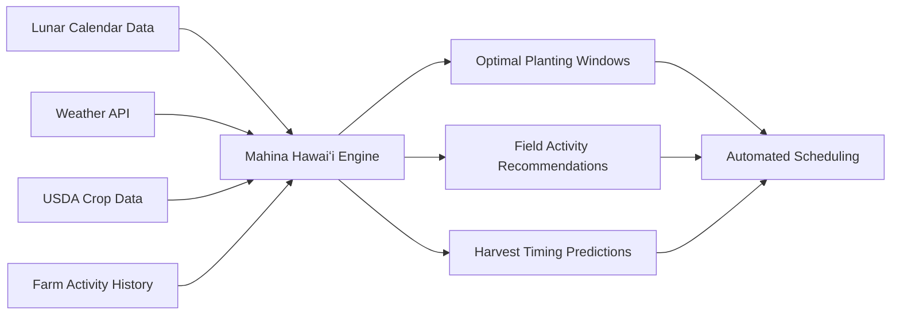

# Barry Henry

**Product Engineer | Full-Stack Developer | Regenerative Farmer | Systems Thinker**

---

## 👋 About Me

I am an Engineer that solves messy, real-world problems with code and tech. I don't just write software; I automate complex systems. Whether it's reverse-engineering ATM protocols for FinTech or building a customer ERP to manage seed lots and planting activities for regenerative agriculture.

Currently, I wear two hats:

**🔧 FinTech Ops:** At Cook Solutions Group, I build the "glue" code that makes legacy banking infrastructure talk to modern APIs, saving hundreds of engineering and troubleshooting hours.

**🌱 AgTech Founder:** I own and operate a regenerative farm on Maui. When I realized existing farm management software was bloated and expensive, I built my own full-stack platform (React/Supabase) to track crops, activities, compliance, weather data, and more.

---

## 🛠️ Tech Stack

<table>
<tr>
<td><strong>Languages</strong></td>
<td><strong>Frameworks & Libraries</strong></td>
<td><strong>Infrastructure & Tools</strong></td>
<td><strong>Domain Expertise</strong></td>
</tr>
<tr>
<td>

</td>
<td>

</td>
<td>

</td>
<td>

</td>
</tr>
</table>

---

## 🚀 Featured Projects

### Happy Harvest ERP

**Full-Stack Farm Management Platform | [Live Demo](https://app.happylaufarms.com)**

A comprehensive resource planning (ERP) system for regenerative farms to track seed lots, planting schedules, and harvests for regulatory, grant, and financing compliance.

#### 🌙 Mahina Hawaiʻi: Native Hawaiian Agricultural Intelligence Engine

**A complex system modeling engine that correlates lunar phases with optimal planting windows, field activities, and harvest timing based on centuries-old Native Hawaiian agricultural practices.**

**Tech Stack:**

- TypeScript, React, Shadcn/UI, Tailwind CSS
- Supabase (PostgreSQL) backend
- Docker containerization
- GitHub Actions CI/CD pipeline
- Zod

**Additional Features:**

- 🌦️ Real-time Weather API integration
- 🌾 USDA Crop Data API integration
- 📱 Mobile-first responsive design for field use
- 📊 Automated grant compliance and regulatory reporting

---

### TelemetryTaco

**Engineering Tool | [GitHub](https://github.com/Agile-Flimflam/TelemetryTaco)**

Part of the Agile-Flimflam engineering collective - high-velocity shipping and "anti-patterns that work."

**Tech Stack:**

- Python
- Django
- Next.js
- Supabase
- Railway deployment
- Zod
- React
- TailwindCSS
- Vite

### Agile-Flimflam

**Engineering Collective | Co-Founder / Engineering Lead**

**Strategic nonsense at scale**

A two-person engineering collective solving business problems with tools that probably shouldn't exist. Specializing in high-velocity shipping, automating manual workflows to zero, and rapid prototyping.

**Focus Areas:**

- Internal tooling
- Workflow automation
- DevOps optimization
- Strategic nonsense

---

## 💼 Professional Experience Highlights

### Cook Solutions Group

**Senior Professional Services Consultant & Solutions Engineer** | _April 2016 – Present_

**Key Achievements:**

- ⚡ **10 hours/week saved** - Developed real-time status dashboard for 35+ Vidyo components, aggregating UDP latency and certificate health metrics
- 🚀 **4 hours/site deployment reduction** - Automated installation and firewall testing of Conveyance Check Imaging software via PowerShell scripts
- 🏦 **150+ financial institutions** - Managed technical rollout of imaging solutions, debugging TCP/UDP handshake failures
- 🔒 **Security Engineering** - Built custom log-scraping tool to detect and hash PII in server logs, eliminating data leak risks
- 🔌 **API Integration** - Engineered middleware to parse XML/TIF transaction data from ATMs and route to vendor APIs via REST

**Technologies:** C#, PowerShell, Python, Azure, Docker, Linux

---

### Common Ground Collective

**President (Technical Operations)** | _October 2023 – October 2025_

**Key Achievements:**

- 💰 **$208,000 in technology grants** secured and managed
- 🔄 **Digital Transformation** - Led migration from fragmented personal emails to centralized Google Workspace & Microsoft 365
- 📊 **Custom Dashboard** - Built donation dashboard using JavaScript and Google Sheets API, unifying data from Stripe and GiveLively
- 👥 **CRM Implementation** - Orchestrated Salesforce rollout to streamline volunteer onboarding and donor management during Lahaina wildfire response

---

## 📊 GitHub Statistics

---

## 🌱 Currently Working On

- Building and scaling Happy Harvest ERP for regenerative agriculture operations
- Automating legacy banking infrastructure integrations at Cook Solutions Group
- Contributing to Common Ground Collective's digital transformation initiatives
- Exploring Native Hawaiian agricultural practices through technology

---

## 📚 Learning

- Advanced system design patterns
- FinTech payment system architectures
- Regenerative agriculture data science
- Native Hawaiian farming methodologies (i.e., Mahina Hawaiʻi)

---

## 💬 Let's Connect

💼 **LinkedIn:** [linkedin.com/in/barrynhenry](https://linkedin.com/in/barrynhenry)

📍 **Location:** Kīhei, Island of Maui, Kingdom of Hawai'i

---

**"Solving messy, real-world problems with code and tech."**

